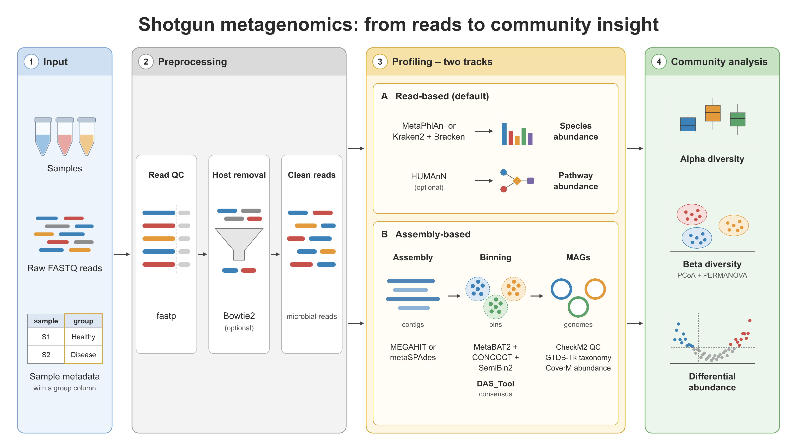

# 🧫 scientific-workflow-viz

[← SciCo-Skills](../../README.md) · a skill in the SciCo-Skills suite

Draw a high-quality, **BioRender-style** scientific figure — a workflow, pipeline, mechanism,
comparison, timeline, or multi-panel infographic — **directly in the VectorCraft desktop app**.
The output is an editable vector file (`.vectorcraft` + SVG / PDF) and a PNG preview, with
**real text labels** (nothing to re-type afterwards).

> **Requires [VectorCraft](https://getartcraft.com/apps/vectorcraft)** — an open-source
> (MIT OR Apache-2.0) desktop vector editor ([source](https://github.com/storytold/vectorcraft)).
> Install it before using this skill; if it is missing, the skill stops and asks you to install it.

> This is the *concept-figure* sibling of [`scientific-data-viz`](../scientific-data-viz):
> use this for schematics/diagrams (no data behind them); use `scientific-data-viz` to plot
> real data.

Example output — the shotgun-analysis pipeline, drawn in VectorCraft by this skill.

## 🤖 Use it in Claude

**Describe the method or process** you want to visualize — Claude designs the figure and draws
it in VectorCraft. For example, just say:

> *"Make a BioRender-style workflow figure for this pipeline."*

The steps below are the method Claude follows to design and draw the figure.

## The 5-step process

1. **Analyze the content** — key entities, steps/relationships, single main message.
2. **Decide the design** — linear pipeline · multi-panel · comparison · stacked levels ·
   cycle/loop · mechanism/network · hybrid (panel count follows the content — never forced to 3).
3. **Set the components** — the concrete blocks and how they connect.
4. **Choose the illustrations** — icons / mini-diagrams grounded in the real method.
5. **Draw it in VectorCraft** — build it in the app, export a PNG, look at it, fix what is wrong,
   and deliver the editable file with SVG / PDF / PNG.

**House style:** flat scientific icons, white background, dark-grey text, soft color-coded
sections with rounded borders / colored header bars, clear arrows, default 16:9.

**Arrows:** one thin dark-grey arrow style, one global reading direction, strictly horizontal
or vertical, each box drawn exactly once.

## Requirement: VectorCraft

1. Install the desktop app from **<https://getartcraft.com/apps/vectorcraft>**.
2. That is all — Claude starts its own VectorCraft window through the app's local control
   server and sends drawing commands with the bundled `vectorcraft_control.py`
   (standard library only, no install). It never attaches to a VectorCraft you already have open.

How the app is started and driven, and the commands used:
**[`vectorcraft-runtime.md`](vectorcraft-runtime.md)** (checked against VectorCraft 0.21.0 on macOS).

Full rules, the design menu, and examples: **[`SKILL.md`](SKILL.md)**.
